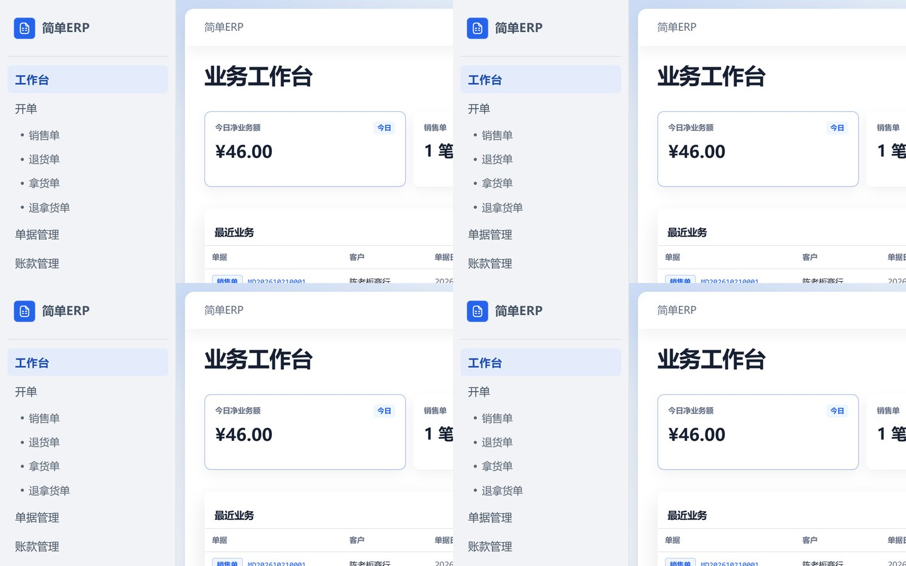
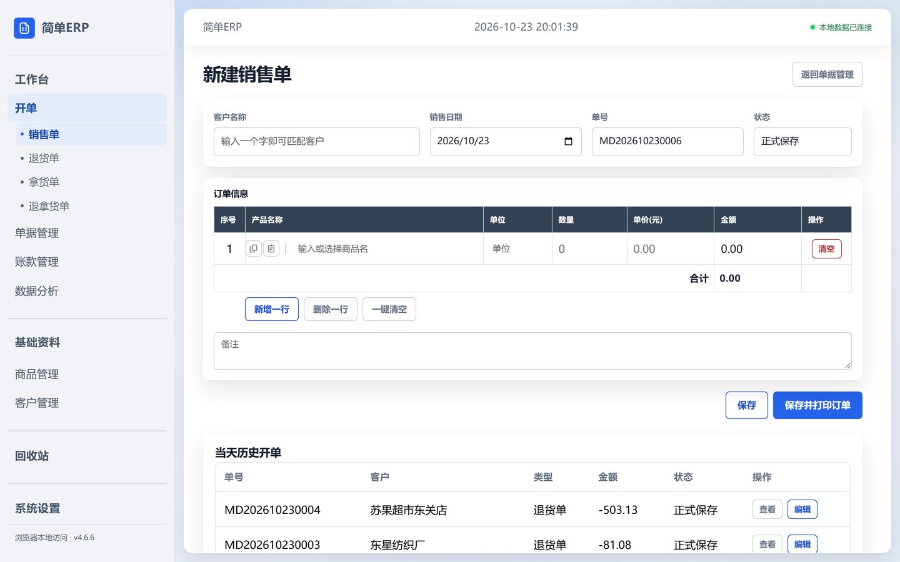
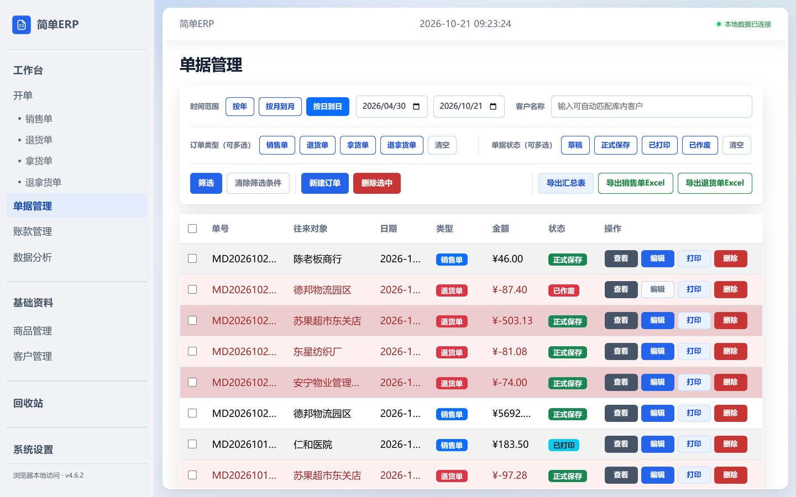
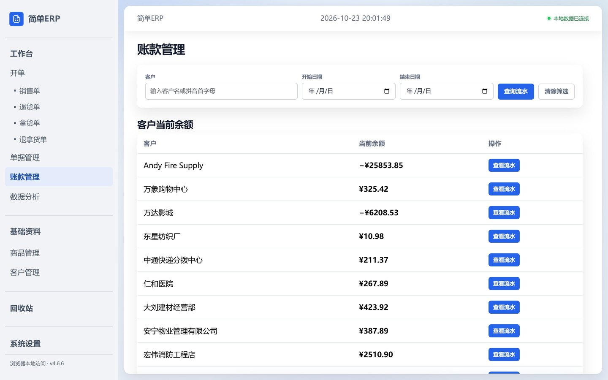
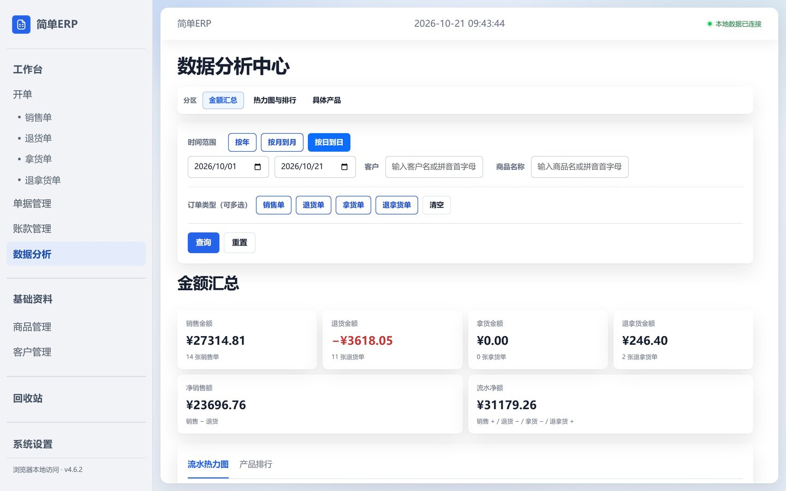
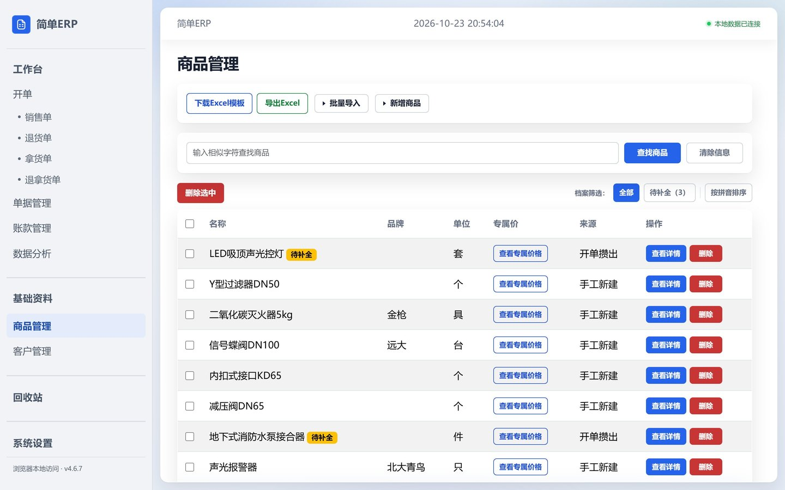
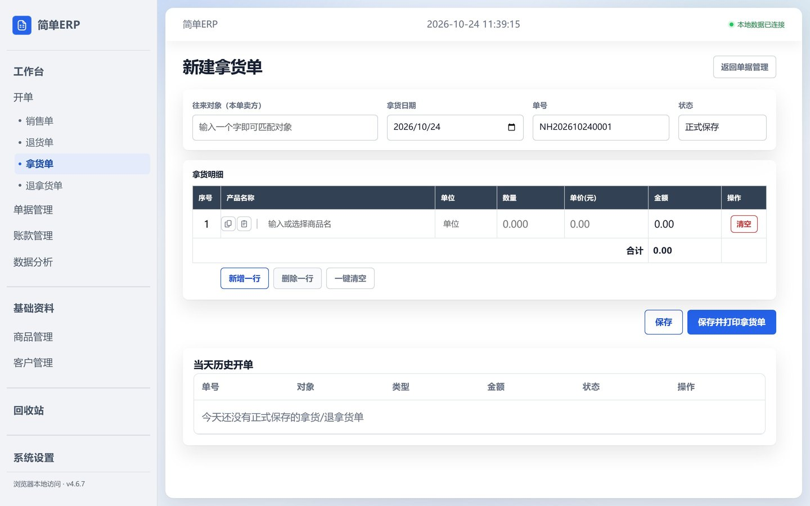
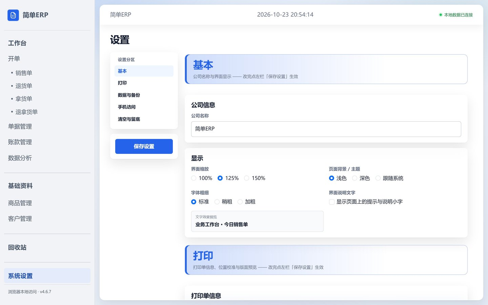
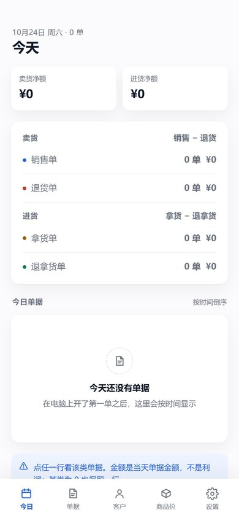

<div align="center">

# 简单ERP

**面向单机门店的轻量开单与账款系统**

开单 · 打印 · 对账 · 手机查账，一台电脑一个文件夹就能跑

[](https://github.com/Astyyym/simple-erp/releases)
[](https://www.python.org/)
[](https://flask.palletsprojects.com/)
[](docs/Windows桌面版打包说明.md)

</div>

---

## 界面预览

<table>
<tr>
<td width="50%"><br><sub><b>工作台</b> · 今日净额、笔数与最近业务</sub></td>
<td width="50%"><br><sub><b>开单</b> · 四类单据同一套录入流程，单价随客户走</sub></td>
</tr>
<tr>
<td><br><sub><b>单据管理</b> · 按类型/状态/日期筛选，导出 Excel</sub></td>
<td><br><sub><b>账款管理</b> · 客户余额与往来流水</sub></td>
</tr>
<tr>
<td><br><sub><b>数据分析</b> · 金额汇总、热力图与产品排行</sub></td>
<td><br><sub><b>商品管理</b> · 专属价、批量导入与拼音检索</sub></td>
</tr>
<tr>
<td><br><sub><b>拿货单</b> · 与销售/退货并列的纯流水单据</sub></td>
<td><br><sub><b>设置</b> · 主题、缩放、打印校准与数据备份</sub></td>
</tr>
</table>

> 截图为绿色版自带的 200 条出厂演示数据，与门店真实账本物理隔离。

---

## 这是什么

一个给本地门店用的桌面 ERP：**卖货开单、打印小票、记账对账**，全部跑在一台 Windows 电脑上，数据存在本地 SQLite，不依赖任何云服务。

- **不需要服务器、不需要联网、永久免登录** —— 双击就开，账本在你自己电脑里。
- **不碰库存**：纯流水 + 账款系统。没有入库出库、没有移动成本、没有毛利核算（`v4.0.0` 起整体移除，schema v15 已物理删表删列）。
- **售价只有一个来源**：该客户的**专属价**。有专属价就自动带出，没有就留空手输，手输价大于 0 会自动学成专属价。

## 核心特性

| | 能力 |
|---|---|
| 🧾 **四类单据** | 销售 / 退货 / 拿货 / 退拿货共用一套录入流程；`MD`、`NH` 两套单号，日期可改、改单保号 |
| 💰 **账款对账** | 客户余额、往来流水、收款与调整（带原因作废留痕）、A4 对账单 PDF |
| 🖨️ **连续纸打印** | 四类开单走 241mm 连续纸一联（逻辑页 215.9×139.7mm），单联 6/8/10/12 行可配 |
| 🔍 **拼音检索** | 名称子串 / 拼音首字母 / 整串全拼，全角括号与空格自动归一 |
| 📋 **行内复制粘贴** | 开单每行一键复制整行、粘贴到下一行，换型号自动清旧价 |
| 📤 **批量导入导出** | 客户 / 商品 `.xlsx`、`.csv` 模板导入，Excel 导出 |
| 📱 **手机只读端** | 同一 WiFi 下手机查今日、单据、欠款、专属价；**只读，改不了账** |
| 🎨 **界面** | 浅色 / 深色 / 跟随系统，100–150% 缩放，字体粗细三档 |

## 快速开始

三种形态，按需选一种。都从 [Releases](https://github.com/Astyyym/simple-erp/releases) 拿。

| 形态 | 产物 | 适合谁 | 演示数据 |
|---|---|---|---|
| **安装包**<br><sub>推荐门店使用</sub> | `simple-erp-setup-vX.Y.Z.exe` | 双击安装，带开始菜单/桌面图标与卸载项；**per-user，不需要管理员** | 无 |
| **绿色包**<br><sub>先试试看</sub> | `simple-erp-windows-vX.Y.Z.zip` | 解压即用、可拷 U 盘；双击 `简单ERP.exe` | **自带 200 条** |
| **手机 APK** | `simple-erp-mobile-vX.Y.Z.apk` | 只读查账，需配合电脑端开启「手机访问」 | — |

**认名字**：带 `setup` 的是安装包；`简单ERP.exe` 是绿色版主程序，双击直接开、不走向导 —— 设计如此。

安装后业务数据在「文档\简单ERP数据」，与程序文件分开：**升级不覆盖 `config.json`，卸载不删数据**。

---

## 功能说明

### 开单与单据

- 销售单、退货单共用录入流程；单价取该客户专属价（无专属价则留空手输，手输 > 0 自动学成专属价）。
- 关闭浏览器对开单字段的历史自动填充，同时保留系统自身的客户/商品联想。
- 每行产品名称左侧有**复制 / 粘贴**图标：复制整行（名称、单位、数量、单价），粘贴到下一行（已是最后一行就自动新增），光标落在新行名称框并全选。**换型号会先清掉粘贴过来的旧价**，不会把上一个型号的价格学成新型号的专属价。
- 单号格式：`MD` + 八位日期 + 四位流水（销售/退货共用当天流水）；`NH` + 八位日期 + 四位流水（拿货/退拿货共用，并让过历史 `TN` 流水，旧单号不重写）。
- 新建日期可改；改单保留原日期和单号；除「已作废」外四类单据都可编辑。
- 一键清空恢复一行明细；单据管理每页 50 条服务端分页，筛选条件保留。

### 客户、商品与账款

- 客户、商品基础资料维护、模糊查询（名称 / 首字母 / 全拼）、Excel 导出。
- `.xlsx` / `.csv` 模板下载与批量导入；同名记录按当前导入规则跳过，字段不全标「待补全」而非拦行。
- 账款按客户汇总：期初余额、有效单据、收款、账务调整；往来流水区分全历史余额与筛选区间净变动。
- 收款与调整支持带原因作废并保留审计记录；作废流水可追溯但不计入余额。
- 「往来交易对账单」出 **A4 竖版 PDF**：整单交易总额只在抬头行印一次，四类各一矩形框，框下三行合计。
- 客户采购统计提供按日销售统计、日期热力图与商品排行；退货不计入采购统计。

### 拿货 / 退拿货

- 与销售/退货并列的**纯流水单据**：统一往来对象、`NH` 单号、打印、对账并入、账款抵扣、回收站、当天历史。
- 退拿货可关联原单原行并控制可退额度 —— **只做追溯与额度，不涉及库存或成本**。

### 数据分析

- 金额汇总、流水热力图、单据流水与产品排行；跨年展示，分页/排序/筛选保持，数量按同单位比较。
- 筛选区客户与商品并排在日期框右侧；客户/商品字段为模糊联想输入（名称子串 / 拼音首字母 / 全拼）。

## 打印与纸型

| 单据 | 纸型 | 说明 |
|---|---|---|
| 四类开单（销售/退货/拿货/退拿货） | **241mm 连续纸一联** | 逻辑页 215.9×139.7mm，左右各 7.3mm 版心；单联默认 10 行，可选 6/8/10/12 |
| 客户货款汇总表 | **A4 竖版** | 210×297mm |
| 往来交易对账单 | **A4 竖版** | 210×297mm |

两套纸型不得混用。打印驱动建议选 A4 横向、实际大小/100%、关闭「适合页面/缩放」（连续纸由驱动居中映射）；横纵偏移与缩放只作用于四类开单和设置页样张。

保存成功后右侧同页显示当前单据真实 PDF，可缩放屏幕显示、保存 PDF 和打印（屏幕缩放不改变 A4 排版）。设置页「打印版面预览」提供四类开单、客户货款汇总、往来对账单三份**真实 PDF 样张**（固定示例数据，不读业务库）。

## 手机端

手机端是桌面端的**只读镜像**：查今日经营、客户欠款、历史单据、商品各客户专属价。**不提供开单、编辑、删除任何入口**。

<div align="center">
<br>
<sub>今日概览 · 卖货/进货两段净额、四类分组、当日时间轴</sub>
</div>

**三步开起来**（电脑端只做一次）：

1. 桌面程序 → **设置 → 手机访问** → 打开开关（手机端走独立第二监听 `5001`，不开这个开关手机连不上）。
2. 记下卡片上的**手机访问地址**（形如 `192.168.10.5:5001`），手机连**同一个 WiFi**。
3. 点「生成配对码」拿 **6 位数字**（120 秒有效、一次性），手机装 APK 后填地址 + 填码，之后免输。

配对是「一台手机一个凭据」：连错 5 次锁 5 分钟；手机丢了或换人用，到电脑 **设置 → 手机访问** 里单独撤销那台设备即可，其它设备不受影响。

| 页签 | 能看到什么 |
|---|---|
| **今日** | 今天卖货/进货两段净额、四类单据分组（某类为 0 也保留一行）、当日单据按时间倒序 |
| **单据** | 历史单据，按年 / 月 / 日筛选；点进看明细 |
| **客户** | 客户列表（按拼音或欠款排序）、当前欠款三段、专属价清单、历史单据、最近流水 |
| **商品价** | 商品列表（名称或拼音搜）、该商品在每个客户的专属价与最近成交差额 |
| **设置** | 电脑地址、重新配对、外观三选、本机配对信息 |

交互：下拉刷新（顶部约 70px 松手，滚到中间不误触发）、返回键两段行为（详情→列表，首页再按退出）、深色模式跟随整壳（含状态栏与导航栏）。

**连不上时按这个顺序查**：① 电脑上的程序开着吗 → ②「手机访问」开关是打开状态吗（重启不自动恢复）→ ③ 手机和电脑同一 WiFi 吗 → ④ 电脑 IP 变了吗（改「设置 → 电脑地址」）→ ⑤ 换网段，或手机浏览器直接开 `http://<IP>:5001/m/` 判断是不是壳的问题。

### 演进路线

| 步骤 | 完成于 | 现状 |
|---|---|---|
| 一、电脑开机 + 手机浏览器直连只读接口 | ✅ `v4.3.0` | 浏览器直连可用（`http://<IP>:5001/m/`） |
| 二、包 APK 壳（图标 / 免输地址 / 下拉刷新 / 免配对） | ✅ `v4.5.0`（壳 1.0.0） | 壳现为 **1.2.0**（`v4.6.1` 交互收口） |
| 三、轻量缓存 → 电脑关机也能读 | ⬜ 未开始 | **下一步** |
| 四、地址换成域名 / 服务器 → 手机端零改动 | ⬜ 未开始 | — |

**当前边界**（不是缺陷，是阶段限制）：电脑关机 / 程序退出 / 开关关闭 → 手机打不开；手机端只读；不显示成本与利润。

---

## 安全边界

**当前版本永久免登录。** 程序面向本机单机使用，默认仅监听 `127.0.0.1`；任何能访问服务端口的人都可操作业务数据。带 `Origin` 或 `Sec-Fetch-Site` 的浏览器写请求执行同源检查，但这不是身份认证。

**不要把服务绑定到 `0.0.0.0`、开放到局域网或公网。** 手机端走独立只读蓝图（蓝图外天然 404、只放 GET、查询走 `mode=ro` 物理只读）。`/health` 为公开健康检查端点，返回 `auth: disabled`。

## 数据保护

升级前：

1. 退出程序，备份设置页显示的整个数据目录，保留原 `config.json`。
2. 更新程序文件；**不要用安装包中的空库覆盖正在使用的 `data\erp.db`**。
3. 若旧安装把数据放在程序旁的 `data\`，尤其不要整目录覆盖。
4. 启动后检查版本与历史单据是否仍在。

用安装包升级不需要先卸载：直接运行新版本即可，它覆盖程序文件、保留 `config.json` 与业务数据。

> ⚠️ **结构升级不可逆**。`v4.0.0` 的 schema v15 已物理删除库存与成本相关 3 表 9 列；老库升级后**不能回退到旧程序**，回退只能靠迁移前自动生成的整库备份。设置页「备份与恢复」会逐份标注备份内的 `schema_version`，旧版结构备份在恢复前即红字提示代价。

---

## 开发

环境要求：**Windows 10/11 + Python 3.11**。首次准备运行 `setup.bat`（创建 `.venv` 并装依赖）。

```bat
setup.bat
.venv\Scripts\python.exe app\app.py                   :: 起服务，http://127.0.0.1:5000
.venv\Scripts\python.exe -m pytest tests\ -q          :: 全量测试
```

健康检查：`http://127.0.0.1:5000/health`。

- 当前质量基线：全量 `pytest` **1053 passed / 1 skipped / 0 failed**；前端 `node --test tests/frontend/*.test.mjs` **103 passed**。
- 打包环境 `.venv-win` 与源码环境分开；隔离实例用 `ERP_PORT` 指定端口、`ERP_DATA_ROOT` 指定数据根，**测试不得污染正式 `data/erp.db`**。
- 桌面版为 PyInstaller one-folder 程序，业务数据目录与程序文件分开。
- **可选 WSL 交叉测试**：在仓库的 `/mnt/d/` 映射目录内进行，确认 `.venv` 已准备；源码预览端口用 `5001`，服务数据根必须设临时目录。Windows 仍是桌面流程与打包环境。详见 [开发说明](docs/开发说明.md)。

### 目录结构

```text
app/
  app.py                  源码服务入口
  erp/
    routes/               蓝图：orders / customers / products / accounts / analytics / purchases / settings / mobile
    services/             业务服务层（单据、账款、检索归一、单号）
    models/               数据访问
    migrations/           schema 迁移（当前 v15）
    templates/            Jinja 模板（desktop + mobile）
    static/               前端 JS / CSS（含开单行组件与联想浮层）
packaging/                打包：spec、默认配置、演示数据生成、Release ZIP
apk/                      安卓壳（Gradle）
tests/                    pytest + 前端 node --test
docs/                     需求、开发、打包说明、界面截图
```

### Windows 桌面版打包

一条命令出齐三种交付产物：

```bat
打包Windows安装包.bat
```

| 形态 | 产物 | 演示数据 |
|---|---|---|
| 绿色版目录 | `dist\local-vX.Y.Z\简单ERP\` | **自带 200 条** |
| 安装包 | `dist\simple-erp-setup-vX.Y.Z.exe` | 无 |
| 交付 ZIP | `dist\simple-erp-windows-vX.Y.Z.zip` | 无 |

- 安装包与 ZIP 是**同一份程序**（正常入口 `简单ERP.spec`），只差投递方式。
- 绿色版是**另一份构建**（`简单ERP-demo.spec` + `packaging/demo_entry.py` 把数据根强制指向包内 `demo_data\`），构建顺序固定：干净产物 → 安装包 → ZIP → 绿色版 → 写演示数据。
- 安装包**必须 per-user**（`{localappdata}\Programs\简单ERP`）—— 程序把可写 `config.json` 写在 EXE 旁，装进受保护目录会让保存设置失败。
- 只保留当前版本产物；新版本打包成功后删除旧 `local-v*` 目录与旧 ZIP，避免用户点错同名 `简单ERP.exe`。

详细步骤与数据目录边界见 [Windows 桌面版打包说明](docs/Windows桌面版打包说明.md)。本地 `dist/` 有文件或源码测试通过，都**不能**证明 GitHub Release 已上传或桌面 EXE 已通过实机验收。

---

## 文档导航

| 文档 | 内容 |
|---|---|
| [需求文档](docs/需求/消防器材店ERP系统-需求文档.md) | 当前权威需求与实现边界 |
| [拿货与对账业务契约](docs/需求/拿货与对账业务契约.md) | 拿货/退拿货与对账口径 |
| [安卓只读端架构决策](docs/需求/2026-10-17_安卓只读端架构决策.md) | 手机端四步路线与只读契约 |
| [开发说明](docs/开发说明.md) | Windows 主环境、WSL 交叉测试、启动与 pytest |
| [打包说明](docs/Windows桌面版打包说明.md) | 三种产物构建、安装、数据目录与安全升级 |
| [遗留问题清单](docs/当前遗留问题与效果待验收清单.md) | 历史反复修改与待验收项的区别 |
| [文档索引](docs/README.md) | 全部文档入口 |

日常运行数据、日志、临时 PDF、备份、虚拟环境和构建产物由 `.gitignore` 排除 —— **不要提交真实业务数据、密钥或个人联系信息**。

## 版本

当前源码版本以根目录 [`VERSION`](VERSION) 为准：**v4.6.3**。

逐版本的交付内容、验收证据与已知边界见 [CHANGELOG](CHANGELOG.md)；已发布版本见 [Releases](https://github.com/Astyyym/simple-erp/releases)。

> README 与 CHANGELOG 不代表远端最新 Release / 安装包已经核实 —— 发版状态以 Release 页面与回验记录为准。

<div align="center"><sub>Flask + SQLite · 本地优先 · 永久免登录（仅本机）</sub></div>
